# GitHub Solar System

Turn a public GitHub profile into a self-contained, animated SVG solar system.

The developer is the sun. Programming languages become planets sized by how much
code they actually represent. Every public repository orbits its primary
language as a moon — with zero-star side projects included. Recent public pushes
streak past as comets. You get a live astronomy poster for your profile README,
regenerated daily by GitHub Actions.

This project is an original, permanent replacement for subscription-gated
profile renderers. It has no paid services, no external renderer, no JavaScript,
and no runtime server.

<p align="center">
  
</p>

## Features

- **Real data only.** Repositories, languages and push activity come straight
  from the public GitHub REST API. Nothing is invented or sample-filled.
- **One planet per language, one moon per repository.** A repository contributes
  only its primary language, so every planet has a well-defined share.
- **Deterministic layout.** The same data always produces byte-identical SVG.
  No timestamps, no random shuffling, no commit noise.
- **Reads well as a static image.** Orbits, labels, gradients and shading are
  complete without animation; optional motion is progressive enhancement.
- **README-safe output.** A single SVG with inline gradients and a system font
  stack: no scripts, no external fonts, no images, no remote resources.
- **Scales gracefully.** Tested from one repository to fifty languages and
  sixty repositories.
- **Free forever.** Standard-library Python generator, MIT licensed.

## How it works

```text
GitHub REST API
      │
      ▼
src/github_client.py   fetch user, repositories, language bytes, events
      │                 pagination · retries · rate limits · fork filtering
      ▼
src/data_models.py     typed User / Repository / Language models
      │
      ▼
src/layout.py          deterministic geometry: planets, moons, stars, comets
      │
      ▼
src/renderer.py        self-contained SVG with atomic file writes
      │
      ▼
output/solar-system.svg
```

### Data sources

| Endpoint | Purpose |
| --- | --- |
| `GET /users/{login}` | Display name, bio, headline counts |
| `GET /users/{login}/repos` | Public repositories, paginated via `Link` |
| `GET /repos/{full_name}/languages` | Language byte breakdown per repository |
| `GET /users/{login}/events/public` | Recent public pushes for comets |

Forks and archived repositories are excluded by default (both configurable).
Repositories without a detected language are counted as *unclassified* in the
metadata line and never rendered as fake planets.

### Language weighting

A repository's primary language is the language with the most bytes in its
language breakdown, falling back to GitHub's `language` field and finally the
repository size when a breakdown is unavailable. Language totals are the sum of
those primary-language byte counts.

Planet radius is a square-root mapping of the language's share of the largest
language:

```text
share  = language_bytes / largest_language_bytes
radius = clamp(6 + 24 · √share, 6, 30)   # pixels, before fit compression
```

The square root keeps a 1% language visible while leaving the dominant language
visibly dominant. Percentages shown in labels and the legend are the language's
share of all classified bytes, so they always add up to 100%.

### Layout

- Planets sit on **elliptical orbits** (up to 1.75:1) so a landscape 16:9 frame
  is used instead of a small circle in the middle.
- Orbits are spaced by a **golden-angle** sequence with per-planet moon zones
  reserved, then uniformly compressed by the minimum factor that fits the canvas.
  Planet discs and moon zones can therefore never overlap.
- Repositories orbit their planet on rings of up to twelve, evenly spaced and
  deterministically rotated per language.
- Labels start just outside their planet, then a bounded candidate search moves
  them until they clear other labels, planets, the header, the legend and the
  repository index.
- Stars and comets are seeded from `sha256(canvas + login)`, never from
  `random.seed()` defaults or the clock.

## Quick start

```bash
git clone https://github.com/Shadow-Monarch-33/github-solar-system.git
cd github-solar-system
python generate.py --username Shadow-Monarch-33 --output output/solar-system.svg
```

Python 3.10+ is required. Generation uses only the standard library. Open the
SVG in any browser, or preview it as a PNG:

```bash
qlmanage -t -s 1200 -o /tmp output/solar-system.svg     # macOS
```

### Offline fixture mode

No network, no API quota:

```bash
python generate.py --fixture tests/fixtures/sample.json --output output/solar-system.svg
```

The bundled fixture uses the real public data for `Shadow-Monarch-33`, so it is
a faithful offline preview.

### Options

| Option | Default | Description |
| --- | --- | --- |
| `--username` | — | GitHub login to visualise |
| `--output` | — (required) | Destination SVG path |
| `--fixture` | — | Read `{user, repos, events}` JSON instead of calling the API |
| `--theme` | `nebula` | `nebula`, `midnight`, `light`, `mono` |
| `--width` / `--height` | `1200` / `675` | Canvas size (minimum 320×240) |
| `--star-density` | `normal` | `off`, `low`, `normal`, `high` |
| `--include-forks` | off | Include forks |
| `--include-archived` | off | Include archived repositories |
| `--no-animation` | off | Static-only SVG |
| `--no-comets` | off | Omit comet decoration |
| `--max-language-fetches` | 15 (50 with token) | Repositories to query for language bytes |

Set `GITHUB_TOKEN` to raise the API limit from 60 to 5,000 requests per hour.
The token is sent only in the `Authorization` header — it never reaches the SVG,
the logs, or the repository.

## Automate with GitHub Actions

The bundled workflow (`.github/workflows/update.yml`) runs daily at
`04:17 UTC`, can be triggered manually from the Actions tab, regenerates the
SVG with the repository's `GITHUB_TOKEN`, validates it, and commits only when
the bytes changed.

```yaml
permissions:
  contents: write

on:
  schedule:
    - cron: "17 4 * * *"
  workflow_dispatch:
```

Because the workflow only reacts to `schedule` and `workflow_dispatch`, the
`[skip ci]` commit cannot retrigger it. If GitHub data cannot be fetched, the
command exits non-zero and the previously committed SVG stays untouched.

## Embed in your profile README

Replace the username and repository if you are using your own fork:

```html
<p align="center">
  
</p>
```

GitHub's image proxy caches assets, so a freshly regenerated SVG may take a
while to appear in a profile README. Deleting the repository's `output` blob
cache by pushing a new commit, or waiting for the cache to expire, resolves it —
nothing in the SVG itself is stale.

## Use it for your own profile

1. Fork this repository.
2. Edit the username in `.github/workflows/update.yml`.
3. Run the workflow once (`Actions → Update solar system → Run workflow`).
4. Point the `` snippet at your fork.
5. Optionally change `--theme`, dimensions or `--star-density` in the workflow.

The generator itself is generic: it works for any public GitHub account.

## Customization

- **Themes** live in `src/styles.py` (`THEMES`). Add a palette to `THEMES` and
  pass `--theme your-name`.
- **Dimensions, star density, forks, archived repos, animation** are CLI flags
  and workflow arguments.
- **Planet scaling** is `_planet_radius` in `src/layout.py`.
- **Spacing** is the `gap` argument to `_fit_orbits` (`24` px up to eight
  languages, `16` px beyond that).
- **Label visibility** is `LABEL_BUDGET` (16) in `src/layout.py`.
- **Moon density** is `MOONS_PER_RING` (12) in `src/layout.py`.
- **Orbit ellipticity** is the `aspect` cap in `build_layout` (1.75).

Every default is tuned so the first run already looks finished.

## Tests

```bash
pip install -r requirements.txt
python -m pytest -q
```

The suite covers API parsing and pagination, retries, rate-limit handling,
language aggregation and fallback, primary-language selection, moon assignment,
determinism, canvas bounds, planet/moon/label collision avoidance, extreme
repository and language counts, XML escaping, SVG validity, absence of scripts,
external assets and tokens, animation toggling, fixture mode and CLI exit codes.

## Known limitations

- GitHub caches rendered images; updates are not instant in profile READMEs.
- Unauthenticated requests are limited to 60 per hour, so only the first 15
  repositories get precise language-byte data unless a token is provided. The
  rest fall back to GitHub's primary language and repository size.
- Profiles with more than 16 languages show the 16 largest planets as labelled;
  the remaining planets stay visible but unlabelled to keep the chart readable.
- SMIL animation support varies across renderers. The static composition is
  always complete, and `--no-animation` removes animation entirely.
- Repositories with no detected language are counted in the metadata line but
  cannot become planets; there is no language to attach them to.
- Only public data is accessible. Private repositories are never fetched.

## Project structure

```text
github-solar-system/
├── .github/workflows/update.yml
├── src/
│   ├── __init__.py
│   ├── colors.py
│   ├── data_models.py
│   ├── github_client.py
│   ├── layout.py
│   ├── renderer.py
│   └── styles.py
├── tests/
│   ├── conftest.py
│   ├── fixtures/sample.json
│   ├── test_cli.py
│   ├── test_github_client.py
│   ├── test_layout.py
│   └── test_renderer.py
├── output/solar-system.svg
├── generate.py
├── requirements.txt
├── LICENSE
└── README.md
```

## License

MIT © 2026 Shadow-Monarch-33. Use it, fork it, restyle it, ship it.
